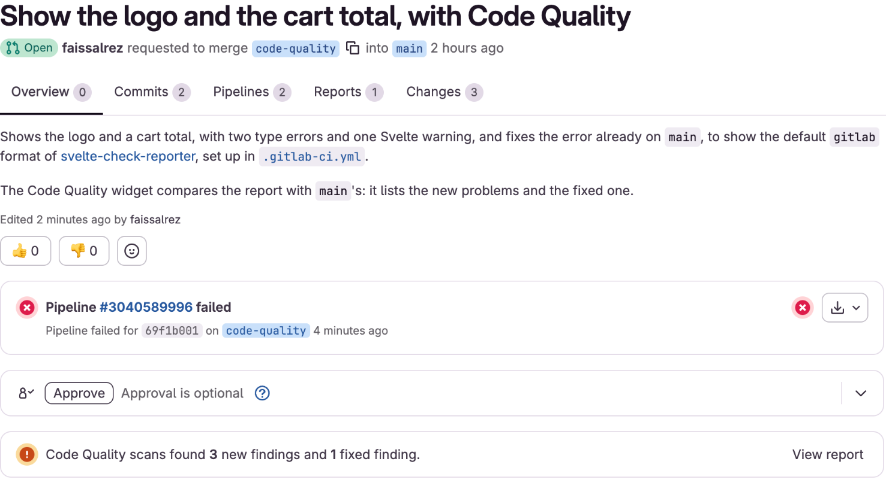
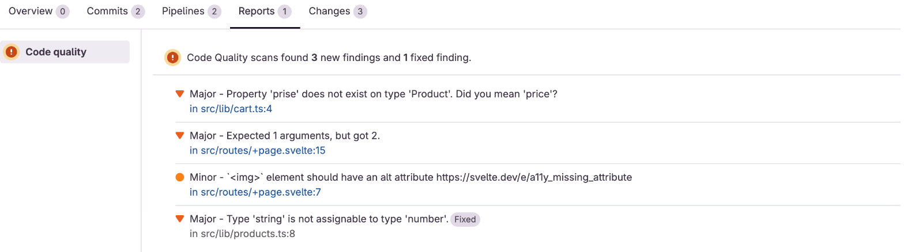
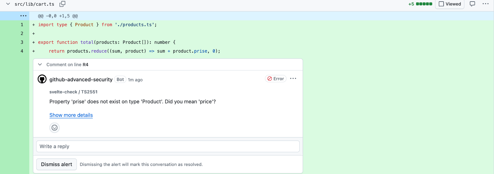
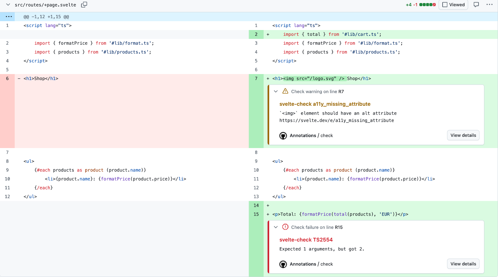

# svelte-check-reporter

[](https://www.npmjs.com/package/svelte-check-reporter)
[](https://github.com/faissalrez/svelte-check-reporter/actions/workflows/ci.yml)

See [svelte-check](https://www.npmjs.com/package/svelte-check)'s type errors where
you review code: in GitLab merge requests and GitHub pull requests, next to your
linter's.

svelte-check only prints its problems to the CI log, and
[won't add other output formats](https://github.com/sveltejs/language-tools/issues/2487).
This package reads its `machine-verbose` output and turns it into:

- a [GitLab Code Quality](https://docs.gitlab.com/ci/testing/code_quality/) report,
  for the merge request widget;
- a [SARIF](https://docs.github.com/code-security/code-scanning/integrating-with-code-scanning/sarif-support-for-code-scanning)
  log, for code scanning comments on GitHub pull requests;
- [GitHub Actions annotations](https://docs.github.com/actions/reference/workflow-commands-for-github-actions),
  for the workflow run and the diff.

One command in your pipeline, no runtime dependencies, no token or app to set up.

```sh
npm install --save-dev svelte-check-reporter
```

## GitLab: new and fixed problems in the merge request



```yaml
check:
  image: node:24-alpine
  script:
    - npm ci
    - npx svelte-kit sync
    - npx svelte-check --output machine-verbose | npx svelte-check-reporter --output-file gl-codequality.json
  artifacts:
    # The report matters most when the check fails
    when: always
    reports:
      codequality: gl-codequality.json
```

- **Only what the merge request changes.** GitLab compares the report with the
  target branch's: the widget shows the problems the merge request adds and the
  ones it fixes, not the ones that were already there.
- **Moving code isn't a new problem.** A problem keeps its identity when lines
  above it are added or removed, and identical problems in one file are still
  told apart (see [how](#how-gitlab-matches-problems-across-pipelines)).
- **Next to ESLint.** The report sits alongside your linter's, for example
  [eslint-formatter-gitlab](https://www.npmjs.com/package/eslint-formatter-gitlab).
  GitLab doesn't show which tool found a problem: add `--prefix '[svelte-check] '`
  to tell them apart.
- Errors are `major`, warnings `minor`.



## GitHub: comments on the pull request, with code scanning



```yaml
jobs:
  check:
    runs-on: ubuntu-latest
    permissions:
      contents: read
      security-events: write
      # Only needed in private repositories
      actions: read
    steps:
      - uses: actions/checkout@v7
      - uses: actions/setup-node@v7
        with:
          node-version: 24
      - run: npm ci
      - run: npx svelte-kit sync
      - run: npx svelte-check --output machine-verbose | npx svelte-check-reporter --format sarif --output-file svelte-check.sarif
      - uses: github/codeql-action/upload-sarif@v4
        # Upload the report even when svelte-check finds errors
        if: ${{ !cancelled() }}
        with:
          sarif_file: svelte-check.sarif
          category: svelte-check
```

- **Only what the pull request adds.** Code scanning compares the results with
  the base branch, and comments on the lines of the diff, in `.svelte` files too.
- **No limit** on the number of problems.
- **Named rules.** Each rule is named after its code, such as `TS2322` or
  Svelte's `state_referenced_locally`, and Svelte's rules link to
  [their documentation](https://svelte.dev/docs/svelte/compiler-warnings).
- Code scanning is available on public repositories, and on private ones with
  GitHub Code Security.

## GitHub: annotations, with nothing to set up



```yaml
jobs:
  check:
    runs-on: ubuntu-latest
    steps:
      - uses: actions/checkout@v7
      - uses: actions/setup-node@v7
        with:
          node-version: 24
      - run: npm ci
      - run: npx svelte-kit sync
      - run: npx svelte-check --output machine-verbose | npx svelte-check-reporter --format github
```

- **Any repository**, without permissions or another action.
- **Every problem**, on the workflow run and on the lines of the pull request's
  diff. GitHub doesn't compare annotations with the base branch: problems that
  were already there are annotated too.
- GitHub shows at most 10 error annotations per step, in svelte-check's order,
  and drops the others without warning. The step's log still lists every problem.
- Run the command from the repository root, so that file paths match the
  repository.

## Annotations or code scanning? Pick one

Both put problems on the lines of the pull request: using both shows each one
twice.

| | Annotations (`github`) | Code scanning (`sarif`) |
| --- | --- | --- |
| Setup | one command | one command, an upload step and `security-events: write` |
| Repositories | all | public, or private with GitHub Code Security |
| Problems shown | all, new or not | the ones the pull request adds |
| Limit | 10 errors per step | none |

Use code scanning when it's available, annotations otherwise.

## A readable log, whatever the format

Every format also prints each problem to the log, then a summary:

```
src/lib/db.ts:29:24  error  Property 'topology' does not exist on type 'MongoClient'.  TS2339

1 error, 0 warnings
```

The command fails like svelte-check: on errors, not on warnings alone (see
[exit codes](#exit-codes)).

## Options

| Option | Default | Description |
| --- | --- | --- |
| `--format <format>` | `gitlab` | `gitlab`, `github` or `sarif`. |
| `--output-file <path>` | required with `gitlab` and `sarif` | Where to write the report. Not allowed with `github`, whose annotations go to the log. |
| `--prefix <text>` | none | Text added before each message, with `gitlab` and `github`, for example `'[svelte-check] '`. Code scanning shows the tool's name, so SARIF doesn't use it. |

## Exit codes

| Code | Meaning |
| --- | --- |
| `0` | No errors (warnings don't fail, as with svelte-check). |
| `1` | svelte-check found errors. |
| `2` | The input or options can't be used: nothing piped in, svelte-check didn't complete, its output isn't `machine-verbose`, or an option is missing or not allowed. |

## Compatibility

| | Supported | Tested |
| --- | --- | --- |
| Node.js | 18.3 and later | 18.3, 18, 20, 22 and 24, in CI |
| svelte-check | versions with `--output machine-verbose` | 4.7 |
| Svelte | any version svelte-check checks | 5 |
| SvelteKit | optional | 2 and 3 |

The reporter only reads svelte-check's output: it doesn't depend on Svelte or
SvelteKit. In a SvelteKit project, run `svelte-kit sync` before svelte-check, as
in the examples above.

## How GitLab matches problems across pipelines

Each problem gets a fingerprint from its file, error code and message, without its
line: a problem keeps its fingerprint when code above it moves. Identical problems
in one file are told apart by their order. The prefix isn't part of the
fingerprint, so adding or changing it doesn't mark problems as new.

## Roadmap

- GitHub annotations: annotate the files changed by the pull request first, so
  that the 10 annotations GitHub shows go to the problems the pull request adds.

## License

MIT
