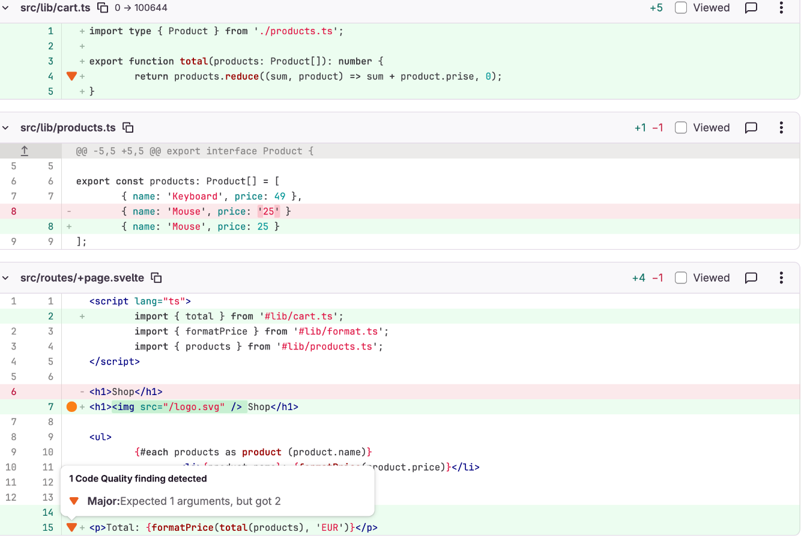

# svelte-check-reporter

[](https://www.npmjs.com/package/svelte-check-reporter)
[](https://github.com/faissalrez/svelte-check-reporter/actions/workflows/ci.yml)

See Svelte and TypeScript errors where you review code: in GitHub pull requests and GitLab merge requests.

Pipe [svelte-check](https://www.npmjs.com/package/svelte-check) into your existing CI to get annotations and native reports. No runtime dependencies.

<picture>
  <source media="(prefers-color-scheme: dark)" srcset="docs/images/github-annotation-dark.png">
  
</picture>

- See new and fixed findings in GitLab, and newly introduced alerts in GitHub code scanning.
- See existing GitLab findings stay matched when lines above them change.
- See errors and warnings at their original severity, with the check failing on errors and passing on warnings alone.

Demos: [GitHub annotations](https://github.com/faissalrez/svelte-check-reporter-demo/pull/1) · [GitHub code scanning](https://github.com/faissalrez/svelte-check-reporter-demo/pull/2) · [GitLab Code Quality](https://gitlab.com/faissalrez/svelte-check-reporter-demo/-/merge_requests/1)

## Get started

Install alongside your existing `svelte-check` dependency:

```sh
npm install --save-dev svelte-check-reporter
```

Add one pipe to your check command:

```sh
# GitHub Actions annotations
npx svelte-check --output machine-verbose | npx svelte-check-reporter --format github

# GitLab Code Quality
npx svelte-check --output machine-verbose | npx svelte-check-reporter --output-file gl-codequality.json
```

For GitHub code scanning, follow the [SARIF setup](#github-code-scanning).

The reporter reads svelte-check's `machine-verbose` output and converts each diagnostic. It handles `.svelte` and `.ts` files, keeps errors and warnings distinct, and prints every diagnostic to the job log.

Requires Node.js 18.3 or later. Run from the repository root so file paths match your repository. For SvelteKit projects, run `npx svelte-kit sync` before the check.

## Choose your integration

Use the format your CI displays natively:

| Integration | What reviewers see | Setup |
| --- | --- | --- |
| [GitLab Code Quality](#gitlab-code-quality) | New and fixed findings in the merge request | Generate a report and declare a job artifact |
| [GitHub annotations](#github-annotations) | Errors and warnings on the workflow run and pull request diff | One command, no upload step |
| [GitHub code scanning](#github-code-scanning) | Tracked alerts, with new findings on the pull request diff | Generate SARIF and upload it |

On GitHub, start with annotations for the least setup. Choose code scanning to track alerts across runs and focus reviews on new findings. Use one of the two to avoid reporting the same diagnostics through both integrations.

## GitLab Code Quality

Show which findings a merge request introduces and which it fixes, alongside reports from your other Code Quality tools.

See the results in the [demo merge request !1](https://gitlab.com/faissalrez/svelte-check-reporter-demo/-/merge_requests/1).

The Reports tab lists new and fixed findings:

<picture>
  <source media="(prefers-color-scheme: dark)" srcset="docs/images/gitlab-reports-dark.png">
  
</picture>

In the Changes view, reviewers can open a finding directly from its marker in the diff:

<picture>
  <source media="(prefers-color-scheme: dark)" srcset="docs/images/gitlab-diff-dark.png">
  
</picture>

Add this job to `.gitlab-ci.yml`:

```yaml
check:
  image: node:24-alpine
  script:
    - npm ci
    - npx svelte-kit sync
    - npx svelte-check --output machine-verbose | npx svelte-check-reporter --output-file gl-codequality.json
  artifacts:
    when: always
    reports:
      codequality: gl-codequality.json
```

Remove the `svelte-kit sync` step if your project doesn't use SvelteKit.

The job must also run on the merge request's target branch, usually `main`. GitLab uses that branch's report as the baseline for identifying new and fixed findings.

Keep `when: always`: the report must reach GitLab even when the check finds errors.

GitLab combines Code Quality reports from multiple jobs. To distinguish svelte-check's messages from other tools, add `--prefix '[svelte-check] '` to the reporter command.

<details>
<summary>How findings stay matched when lines move</summary>

Each finding gets a fingerprint from its file, error code and message. The line number isn't included, so adding or removing lines above a finding doesn't make it new.

Identical findings in the same file are distinguished by their order. Changing the message prefix doesn't change fingerprints.

</details>

## GitHub annotations

Annotate errors and warnings on your workflow run and pull request diff, as shown in the opening screenshot. No additional action, personal access token or annotation permissions required.

See the annotations in [demo pull request #1](https://github.com/faissalrez/svelte-check-reporter-demo/pull/1).

Save this workflow as `.github/workflows/check.yml`:

```yaml
name: Svelte check

on: [pull_request]

permissions:
  contents: read

jobs:
  check:
    runs-on: ubuntu-latest
    steps:
      - uses: actions/checkout@v7
      - uses: actions/setup-node@v7
        with:
          node-version: 24
      - run: npm ci
      - run: npx svelte-kit sync
      - run: npx svelte-check --output machine-verbose | npx svelte-check-reporter --format github
```

Remove the `svelte-kit sync` step if your project doesn't use SvelteKit. To annotate pushes too, use `on: [push, pull_request]`.

Annotations include existing findings: GitHub doesn't compare this format with the base branch. GitHub displays at most [10 error and 10 warning annotations per step](https://docs.github.com/en/rest/checks/runs#create-a-check-run). Every diagnostic remains in the job log, including those beyond the annotation limit.

## GitHub code scanning

Track alerts across runs and show newly introduced findings on the pull request diff, including in `.svelte` files.

See the alerts in [demo pull request #2](https://github.com/faissalrez/svelte-check-reporter-demo/pull/2).

<picture>
  <source media="(prefers-color-scheme: dark)" srcset="docs/images/github-code-scanning-dark.png">
  
</picture>

Rules use their diagnostic codes, such as `TS2322` or `state_referenced_locally`. Svelte compiler rules link to their documentation.

Save this workflow as `.github/workflows/check.yml`, using it instead of the annotations workflow:

```yaml
name: Svelte check

on:
  push:
    branches: [main]
  pull_request:

jobs:
  check:
    runs-on: ubuntu-latest
    permissions:
      contents: read
      security-events: write
      actions: read # Required for private repositories
    steps:
      - uses: actions/checkout@v7
      - uses: actions/setup-node@v7
        with:
          node-version: 24
      - run: npm ci
      - run: npx svelte-kit sync
      - run: npx svelte-check --output machine-verbose | npx svelte-check-reporter --format sarif --output-file svelte-check.sarif
      - uses: github/codeql-action/upload-sarif@v4
        if: ${{ !cancelled() }}
        with:
          sarif_file: svelte-check.sarif
          category: svelte-check
```

Remove the `svelte-kit sync` step if your project doesn't use SvelteKit. Replace `main` with your target branch if it has a different name.

The workflow also analyzes the target branch so GitHub can identify new findings. `security-events: write` permits the upload, and `if: ${{ !cancelled() }}` uploads the report even when the check finds errors.

<details>
<summary>Alert matching and SARIF limits</summary>

The reporter leaves fingerprint generation to `upload-sarif`. GitHub uses the source files to [match alerts across analyses](https://docs.github.com/en/code-security/reference/code-scanning/sarif-files/sarif-support#data-for-preventing-duplicated-alerts), allowing findings to stay matched when their line numbers change.

SARIF uses a separate upload path from workflow annotations. GitHub's [SARIF limits](https://docs.github.com/en/code-security/reference/code-scanning/sarif-files/sarif-support#file-compatibility) still apply, including limits on uploaded and displayed results.

</details>

## Diagnostics and exit codes

Every format preserves the diagnostic's severity:

| svelte-check | GitLab Code Quality | GitHub annotations | GitHub code scanning |
| --- | --- | --- | --- |
| Error | `major` | Error annotation | `error` |
| Warning | `minor` | Warning annotation | `warning` |

The job log includes each diagnostic and a summary:

```text
src/lib/db.ts:29:24  error  Property 'topology' does not exist on type 'MongoClient'.  TS2339

1 error, 0 warnings
```

Errors fail the command. Warnings alone don't. The reporter's exit code decides the job's result, so svelte-check's `--fail-on-warnings` has no effect through the pipe.

| Exit code | Meaning |
| --- | --- |
| `0` | No errors. Warnings are allowed. |
| `1` | svelte-check reported errors. |
| `2` | The reporter couldn't complete: invalid options, missing or unreadable input, incomplete svelte-check output, or a report-writing failure. |

If svelte-check crashes before completing, the reporter fails rather than producing an empty report that looks clean.

## CLI reference

The reporter reads from standard input. Use these options to choose its output:

| Option | Default | Description |
| --- | --- | --- |
| `--format <format>` | `gitlab` | Output format: `gitlab`, `github` or `sarif`. |
| `--output-file <path>` | None | Required for `gitlab` and `sarif`. The reporter creates missing parent directories. Not allowed with `github`, which prints annotations to the log. |
| `--prefix <text>` | None | Prepend text to messages in `gitlab` and `github`, for example `'[svelte-check] '`. Ignored by `sarif`, where GitHub displays the tool's name. |

## Compatibility

The reporter reads svelte-check's output without importing Svelte or SvelteKit:

| Dependency | Supported | Tested |
| --- | --- | --- |
| Node.js | 18.3 and later | 18.3, 18, 20, 22 and 24 in [CI](.github/workflows/ci.yml) |
| svelte-check | Versions with `--output machine-verbose` | 4.7 |
| Svelte | Versions checked by svelte-check | 5 |
| SvelteKit | Optional | 2 and 3 |

## Troubleshooting

<details>
<summary>The GitLab report doesn't show new and fixed findings</summary>

Check that the target branch has a completed pipeline with a Code Quality report. GitLab needs this baseline to compare the merge request's findings.

Also keep `artifacts: when: always` so the report is uploaded when svelte-check finds errors.

</details>

<details>
<summary>The same finding appears twice on a GitHub pull request</summary>

GitHub's new diff view can show a code scanning alert twice: once as a bot comment and once as an annotation from the code scanning check.

Both refer to the same alert.

</details>

## Roadmap

Prioritize GitHub annotations for files changed by the pull request, so the available annotation slots go to those files first.

## License

[MIT](LICENSE)
